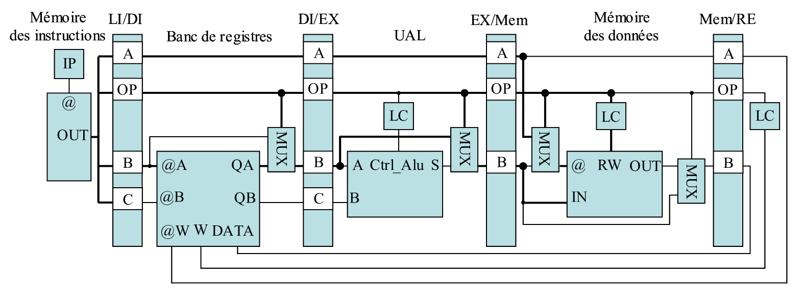
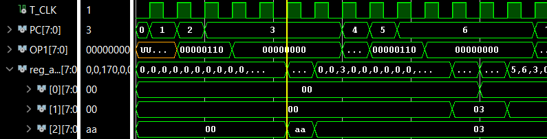
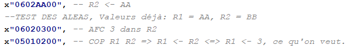
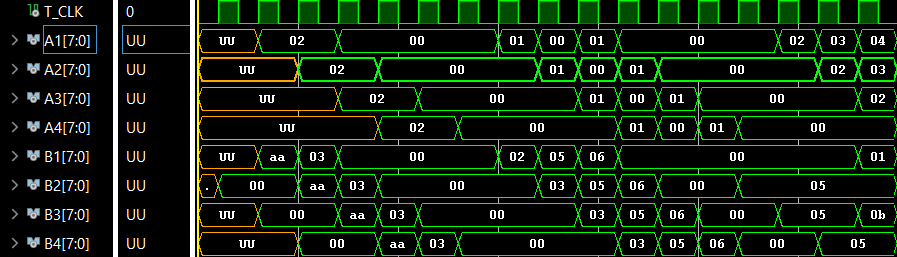
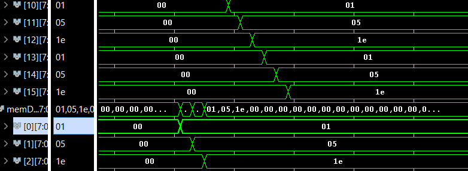
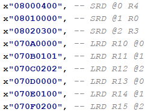
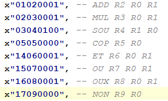
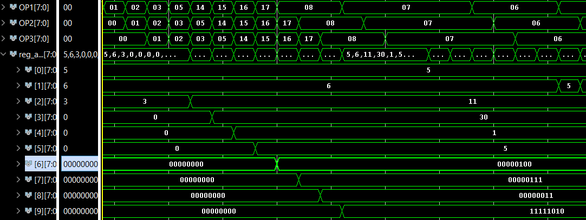

# µP RISC

Autumn 2025

COURSE       : VHDL & PROGRAMMABLE DIGITAL CIRCUITS

Professor   : Ms. D. Dragomirescu

Students    : [TABAN, Aleksander](https://codeberg.org/ataban/RISC_microprocesseur) & [JOHNSEN, Brage](https://github.com/Tournesol02) ([LinkedIn](https://www.linkedin.com/in/bfjohnsen/))


RISC microprocessor developed as part of a practical engineering project for a VHDL course in the 4th year at INSA Toulouse. We used AMD/Xilinx Vivado, GHDL and GTKWave to develop and test the microprocessor. Outside the scope of the course, we also added an assembler-to-machine-code translation program ("compiler"), written in C, to facilitate testing of the microprocessor.


## Microprocessor operation

Here is the architecture of the microprocessor:



The instruction memory has a capacity of 64 * 32 = 2048 bits. The register bank has a capacity of 16 * 8 = 128 bits. The ALU provides the overflow, carry and negative flags as outputs, when applicable. The data memory has a capacity of 256 * 8 = 2048 bits. The datapath handles all hazards that may occur. More information about its operation can be found in [the assignment](./Sujet4AE2025.pdf).


## Instructions

| Operation               | Code | Operation code | English opcode (non-functional) | A   | B   | C   | Description                    |
| ----------------------- | ---- | -------------- | -------------------------------- | --- | --- | --- | ------------------------------ |
| No operation            | 0x00 | AOP              | NOP                              | \_   | \_   | \_   | \_                              |
| Addition                | 0x01 | AJ               | ADD                              | R_i | R_j | R_k | \\[R_i\\] <- \\[R_j\\] + \\[R_k\\]   |
| Multiplication          | 0x02 | MUL              | MUL                              | R_i | R_j | R_k | \\[R_i\\] <- \\[R_j\\] \* \\[R_k\\]   |
| Subtraction             | 0x03 | SOU              | SUB                              | R_i | R_j | R_k | \\[R_i\\] <- \\[R_j\\] - \\[R_k\\]   |
| Copy                    | 0x05 | COP              | COP                              | R_i | R_j | \_   | \\[R_i\\] <- \\[R_j\\]             |
| Register assignment     | 0x06 | AFC              | AFC                              | R_i | j   | \_   | \\[R_i\\] <- j                   |
| Load from memory        | 0x07 | CRD              | LOAD                             | R_i | @\_j | \_   | \\[R_i\\] <- \\[@\_j\\]             |
| Store to memory         | 0x08 | SRD              | STORE                            | R_i | R_j | \_   | \\[@\_i\\] <- \\[R_j\\]             |
| Bitwise AND             | 0x14 | ET               | AND                              | R_i | R_j | R_k | \\[R_i\\] <- \\[R_j\\] ET  \\[R_k\\] |
| Bitwise OR              | 0x15 | OU               | OR                               | R_i | R_j | R_k | \\[R_i\\] <- \\[R_j\\] OU  \\[R_k\\] |
| Bitwise XOR             | 0x16 | OUX              | XOR                              | R_i | R_j | R_k | \\[R_i\\] <- \\[R_j\\] OUX \\[R_k\\] |
| Bitwise NOT             | 0x17 | NON              | NOT                              | R_i | R_j | \_   | \\[R_i\\] <- NON \\[R_j\\]         |

The instructions follow the following format (example):

| Instruction: | AJ       | R1       | R9       | R4       |
| ------------- | -------- | -------- | -------- | -------- |
| Hexadecimal:  | 0x01     | 0x01     | 0x09     | 0x04     |
| Binary:       | 00000001 | 00000001 | 00001001 | 00000100 |

Both spaces and commas are accepted as separators between words in an instruction.


## How to use the compiler

Modify the assembly code in [code.s](./compilateur/code.s) in the [compilateur](./compilateur/) directory according to the RISC language described in the table above. Then, open a terminal and change the working directory using the following command:

```cd compilateur```

Then run the following command in the terminal to test:

```./test.sh```

Or, if you want to check the code using Valgrind:

```./valTest.sh```

The new machine code will be located in [auto_memoire_instructions.vhd](./compilateur/auto_memoire_instructions.vhd). For now, it must be manually copied into [MEMOIRE_INSTRUCTIONS.vhd](./microprocesseur/MEMOIRE_INSTRUCTIONS.vhd), pending a new version of the compiler.

Using the compiler can be risky, so please use it with caution. The compiler is not yet fully complete and will be improved in the future.


## Figures

The following figures illustrate the correct operation of the microprocessor:





Figure 1 and 2: Hazard handling. We write 03 to register R2, which already contains AA, and then immediately copy it to R1. We can see that the program stalls (program counter (PC) incrementation temporarily stops) for at least 5 clock cycles.



Figure 3: The program pipeline: we can clearly see the instructions progressing through the different stages.





Figure 4 and 5: Loading and storing between the register bank and the data memory.





Figure 6 and 7: Arithmetic operations. We perform ADD, MUL, SOU, ET, OU, OUX, NON.


## Explanation of the directory structure

The microprocessor components and the microprocessor itself are located in the [microprocesseur](./microprocesseur/) directory.

The test benches for all the microprocessor components, as well as the test bench for the assembled microprocessor (datapath), are located in the [bancs](./bancs/) directory.

The compiler, as well as the code to be compiled, is located in the [compilateur](./compilateur/) directory.

The assignment followed throughout the semester is called [Sujet4AE2025.pdf](./Sujet4AE2025.pdf).


## License : CC-BY-NC-SA 4.0

See the [LICENSE](./LICENSE) file for more information about the license.
