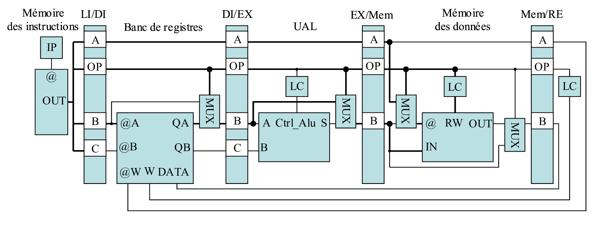
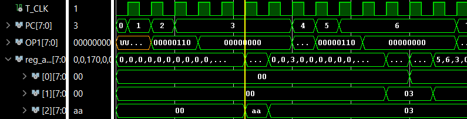
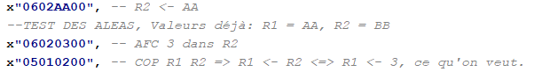
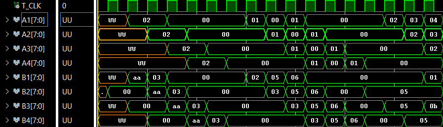
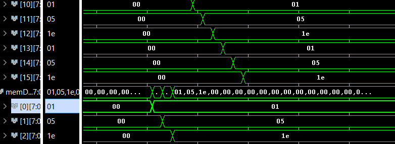
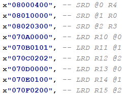
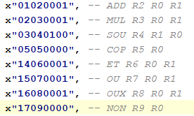
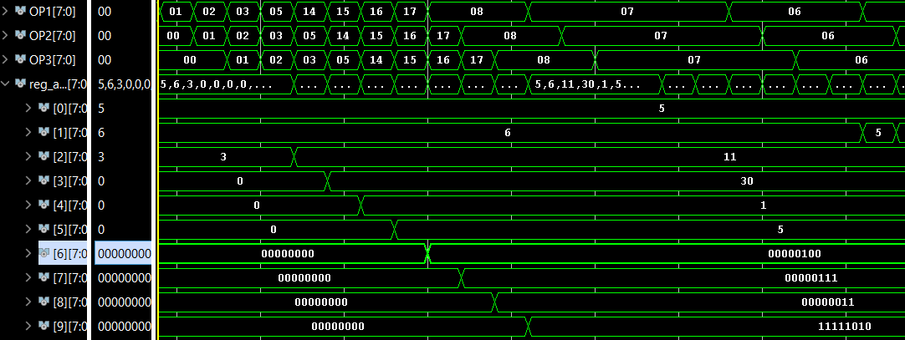

# µP RISC

L'automne 2025

COURS       : VHDL & CIRCUITS NUMERIQUES PROGRAMMABLES

Professeure : Mme. D. Dragomirescu

Étudiants   : [TABAN, Aleksander](https://codeberg.org/ataban/RISC_microprocesseur) & [JOHNSEN, Brage](https://github.com/Tournesol02) ([LinkedIn](https://www.linkedin.com/in/bfjohnsen/))


Microprocesseur RISC crée dans le cadre d'un bureau d'étude dans un cours de VHDL en 4ème année de l'INSA Toulouse. Nous avons utilisé AMD/Xilinx Vivado, GHDL ainsi que GTKWave pour developper et tester le microprocesseur. Hors le cadre du cours, nous avons aussi ajouté un programme de traduction ("compilateur") assembleur - langage machine, écrit en C, pour faciliter le test du microprocesseur.


## Fonctionnement du microprocesseur

Voici l'architecture du microprocesseur :



La mémoire des instructions fait 64 * 32 = 2048 bits. Le registre fait 16 * 8 = 128 bits. L'UAL donne les fanions de dépassement, carry et negatif en sortie, si c'est le cas. La mémoire de données fait 256 * 8 = 2048 bits. Le chemin de données gère tous les aléas qui peuvent apparaitre. Plus d'informations sur le fonctionnement dans [le sujet](./Sujet4AE2025.pdf).


## Les instructions

| Opération               | Code | Code d'opération | Opcode anglais (non fonctionnel) | A   | B   | C   | Description                    |
| ----------------------- | ---- | ---------------- | -------------------------------- | --- | --- | --- | ------------------------------ |
| Aucune opération        | 0x00 | AOP              | NOP                              | _   | _   | _   | _                              |
| Addition                | 0x01 | AJ               | ADD                              | R_i | R_j | R_k | \[R_i\] <- \[R_j\] + \[R_k\]   |
| Multiplication          | 0x02 | MUL              | MUL                              | R_i | R_j | R_k | \[R_i\] <- \[R_j\] * \[R_k\]   |
| Soustraction            | 0x03 | SOU              | SUB                              | R_i | R_j | R_k | \[R_i\] <- \[R_j\] - \[R_k\]   |
| Copie                   | 0x05 | COP              | COP                              | R_i | R_j | _   | \[R_i\] <- \[R_j\]             |
| Affectation en registre | 0x06 | AFC              | AFC                              | R_i | j   | _   | \[R_i\] <- j                   |
| Chargement en registre  | 0x07 | CRD              | LOAD                             | R_i | @_j | _   | \[R_i\] <- \[@_j\]             |
| Sauvegarde en registre  | 0x08 | SRD              | STORE                            | R_i | R_j | _   | \[@_i\] <- \[R_j\]             |
| Et binaire              | 0x14 | ET               | AND                              | R_i | R_j | R_k | \[R_i\] <- \[R_j\] ET  \[R_k\] |
| Ou binaire              | 0x15 | OU               | OR                               | R_i | R_j | R_k | \[R_i\] <- \[R_j\] OU  \[R_k\] |
| Ou exclusif binaire     | 0x16 | OUX              | XOR                              | R_i | R_j | R_k | \[R_i\] <- \[R_j\] OUX \[R_k\] |
| Non binaire             | 0x17 | NON              | NOT                              | R_i | R_j | _   | \[R_i\] <- NON \[R_j\]         |

Les instructions suivent le format suivant (exemple) :

| Instruction : | AJ       | R1       | R9       | R4       |
| ------------- | -------- | -------- | -------- | -------- |
| Hexadécimal : | 0x01     | 0x01     | 0x09     | 0x04     |
| Binaire :     | 00000001 | 00000001 | 00001001 | 00000100 |

Les espaces et les virgules sont tous les deux acceptès pour séparer les mots dans l'instruction.


## Comment utiliser le compilateur

Modifier le code en assembleur de [code.s](./compilateur/code.s) dans [compilateur](./compilateur/) en règle avec le langage RISC décrit dans la table en haut. En suite, lancez un terminal et changez de répértoire de travail avec la commande suivante :

```cd compilateur```

Puis lancer le code suivant dans le terminal pour tester :

```./test.sh```

ou si vous voulez verifier mon code en utilisant valgrind,

```./valTest.sh```

Le nouveau code en langage machine se trouvera dans [auto_memoire_instructions.vhd](./compilateur/auto_memoire_instructions.vhd). Il devra pour le moment être mis dans [MEMOIRE_INSTRUCTIONS.vhd](./microprocesseur/MEMOIRE_INSTRUCTIONS.vhd) à la main, en attendant une nouvelle version du compilateur.

L'utilisation du compilateur peut être risquée, donc à utiliser avec précautions. Le compilateur n'est pas encore entièrement fini, et sera amelioré dans le futur.


## Figures

Ici suivent des figures explicatives pour démontrer que le microprocesseur fonctionne bien :





Figure 1 et 2: Gestion d'aléas. Nous mettons 03 dans le registre R2, qui contient déjà AA, puis on copie direct dans R1. On peut voir que le programme se pause (incrementation du compteur programme (PC) s'arrête temporairement) pendant au moins 5 cycles d'horloge.



Figure 3: L'escalier du programme, on voit bien que les instructions sont enchainés aux differents étages.





Figure 4 et 5: Chargement et sauvegarde entre le banc de registres et la memoire des données.





Figure 6 et 7: Partie arithmétique. On fait ADD, MUL, SOU, ET, OU, OUX, NON.


## Explication de la structure des répértoires

Les composants du microprocesseur et le microprocesseur lui-même, sont dans le répértoire [microprocesseur](./microprocesseur/).

Les bancs de test pour tous les composants du microprocesseur et le banc de test pour le microprocesseur assemblé (chemin de données), sont sous le répértoire [bancs](./bancs/).

Le compilateur, ainsi que le code à compiler existe sous le répértoire [compilateur](./compilateur/).

Le sujet suivi pendant le semestre s'appelle [Sujet4AE2025.pdf](./Sujet4AE2025.pdf).


## License : CC-BY-NC-SA 4.0

Voir le fichier [LICENSE](./LICENSE) pour plus d'informations sur la license.


